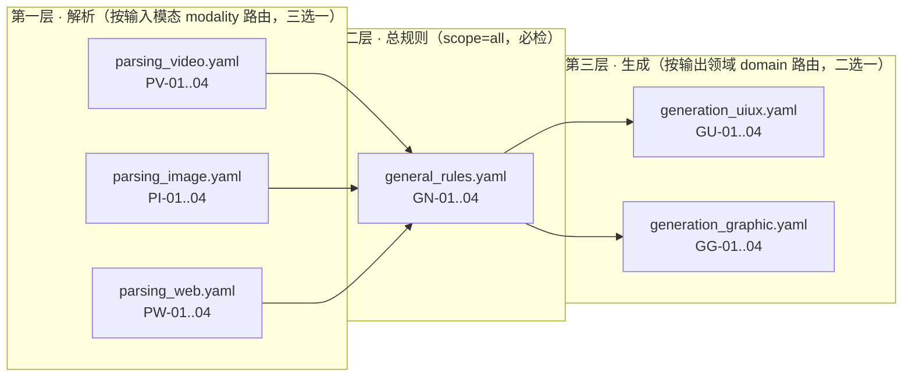
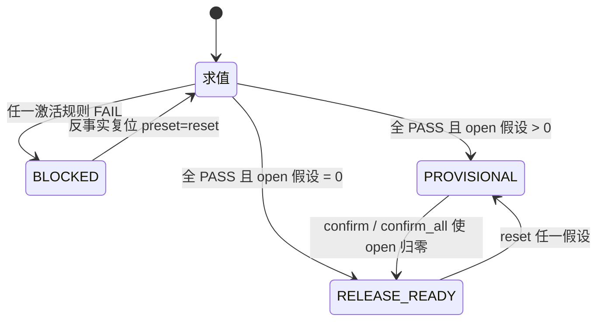
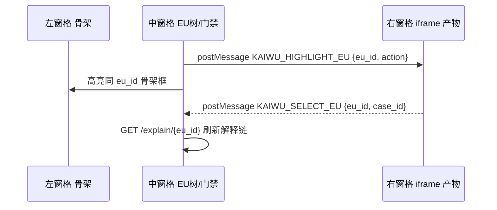

# 开物 v3.4 · 权威架构与 JSON API 契约

> 产品：开物 · Kaiwu Adaptive-EU Design Workbench　版本：`3.4.0`　端口：`4340`
> 核心基线：Code XR · Glass Workspace（视频 → UI/UX），同源对照：Code XR 品牌视觉展板（图片 → 平面设计）

本文是 v3.4 规则、模板、语义中间表示（IR）、后端 API 与前端联动协议的唯一权威口径。规则正文以 `rules/*.yaml` 为准，模板正文以 `templates/*.yaml` 为准，本文负责说明它们如何组合与被消费。

---

## 1. 设计目标

| 目标 | v3.3 遗留问题 | v3.4 做法 |
| --- | --- | --- |
| 整片结案 | 只补查 1.60–2.23 s，整段 5.689 s 黄灯未结案 | PV-01 全时段切分闭合，Code XR 6 段连续覆盖 100% |
| 规则零特例 | 规则按项目点名交互与数值 | 24 条通用规则，阈值只写通用值，项目差异来自 skeleton 与模板 |
| 结构自适应 | 固定颗粒度，交互密区过粗、重复项过细 | 模板锚定 + 分裂 / 折叠 / 裁剪 自适应伸缩 |
| 树图分离 | 交互被建成包含关系 | 纵向六级树 + 6 类白名单横向边 |
| 诚实放行 | 网页通过即报验收、EU 缺席 | No-Evidence-No-Verified + 三态准入状态机 |
| 可证伪 | 规则是否真拦截无从验证 | 24 个反事实预设在内存沙盒真实改写快照并由同一规则引擎检出 |

## 2. Y 型双向路由：三层正交规则体系



- 全库：6 个 YAML × 4 条 = **24 条** BLOCKER 硬规则。
- 单项目激活：`解析模态(4) + 总规则(4) + 生成领域(4)` = **12 条**。
- 路由键：文件头 `route_key` 指明匹配字段（`modality` / `scope` / `domain`）；项目 `case_info.modality` 与 `case_info.domain` 决定激活哪两个文件，`general_rules.yaml` 恒激活。
- 求值顺序：`parsing → general → generation`，层内按规则 ID 升序。

### 2.1 激活矩阵

| 案例 | modality | domain | 激活规则 | 模板 |
| --- | --- | --- | --- | --- |
| `code_xr_uiux` | video | uiux | PV-01..04 + GN-01..04 + GU-01..04 | `tpl_uiux_workspace_v1` |
| `code_xr_poster` | image | graphic | PI-01..04 + GN-01..04 + GG-01..04 | `tpl_graphic_poster_v1` |
| web 夹具（engine 内置） | web | uiux | PW-01..04 + GN-01..04 + GU-01..04 | `tpl_uiux_workspace_v1` |

### 2.2 24 条规则一览

| 层 | ID | 名称 | check_code | 反事实预设 |
| --- | --- | --- | --- | --- |
| 解析·视频 | PV-01 | 全时段关键帧覆盖与场景切分闭合 | `check_pv01_timeline_coverage` | `violate_PV01_partial_video_coverage` |
| 解析·视频 | PV-02 | 视频外版式噪声剥离与有效视口裁切 | `check_pv02_viewport_crop` | `violate_PV02_layout_noise_leak` |
| 解析·视频 | PV-03 | 瞬态滚动与稳态真值分离及假设隔离 | `check_pv03_transient_isolation` | `violate_PV03_transient_value_as_truth` |
| 解析·视频 | PV-04 | 帧间不变量与连续交互取证 | `check_pv04_interaction_evidence` | `violate_PV04_unbound_interaction_evidence` |
| 解析·图片 | PI-01 | 版面栅格与比例尺寸链闭合 | `check_pi01_grid_size_chain` | `violate_PI01_grid_chain_break` |
| 解析·图片 | PI-02 | 视觉去噪与前景图文/背景材质分离 | `check_pi02_layer_separation` | `violate_PI02_foreground_background_merge` |
| 解析·图片 | PI-03 | 色彩对比度、字阶与间距原子采样合法性 | `check_pi03_atom_sampling` | `violate_PI03_illegal_atom_sample` |
| 解析·图片 | PI-04 | 原图 evidence_bbox 强绑定 | `check_pi04_evidence_bbox` | `violate_PI04_missing_evidence_bbox` |
| 解析·网页 | PW-01 | 多断点 DOM 几何闭合 | `check_pw01_breakpoint_geometry` | `violate_PW01_breakpoint_misalignment` |
| 解析·网页 | PW-02 | 计算样式向设计 Token 归一 | `check_pw02_token_normalization` | `violate_PW02_raw_style_literal` |
| 解析·网页 | PW-03 | 交互状态与无障碍角色提取 | `check_pw03_states_and_a11y` | `violate_PW03_missing_a11y_role` |
| 解析·网页 | PW-04 | 静态装饰与业务数据边界分离 | `check_pw04_decor_data_boundary` | `violate_PW04_decor_data_mixed` |
| 总规则 | GN-01 | 树图分离与度约束 | `check_gn01_tree_graph_separation` | `violate_GN01_interaction_in_tree` |
| 总规则 | GN-02 | 模板锚定与复杂度自适应伸缩合规 | `check_gn02_template_adaptive_compliance` | `violate_GN02_degree_overflow` |
| 总规则 | GN-03 | 单源双索引 L5 原子 100% 挂载与 No-Evidence-No-Verified | `check_gn03_atomic_registry_coverage` | `violate_GN03_missing_l5_atom` |
| 总规则 | GN-04 | 包络自底向上守恒与三态准入状态机 | `check_gn04_envelope_and_admission` | `violate_GN04_envelope_overflow` |
| 生成·UI/UX | GU-01 | L5 设计与动效 Token 原子 100% 强制消费 | `check_gu01_token_consumption` | `violate_GU01_token_bypass` |
| 生成·UI/UX | GU-02 | 根治 UI 实心退化：真可编辑 DOM 文本与弹性容器 | `check_gu02_live_dom_not_bitmap` | `violate_GU02_bitmap_solid_degradation` |
| 生成·UI/UX | GU-03 | 微交互与状态闭环保真 | `check_gu03_edge_realization` | `violate_GU03_missing_proximity_magnify` |
| 生成·UI/UX | GU-04 | 在线舞台与导出产物溯源 ID 回检及零防御性小字 | `check_gu04_readback_and_microcopy` | `violate_GU04_defensive_microcopy` |
| 生成·平面 | GG-01 | 画幅尺寸出血与网格对齐守恒 | `check_gg01_canvas_bleed_grid` | `violate_GG01_bleed_grid_break` |
| 生成·平面 | GG-02 | 视觉主次字阶层级与对比度合规 | `check_gg02_hierarchy_contrast` | `violate_GG02_hierarchy_inversion` |
| 生成·平面 | GG-03 | 矢量/文字图层独立可编辑 | `check_gg03_editable_layers` | `violate_GG03_rasterized_text` |
| 生成·平面 | GG-04 | 导出重开版式零漂移与溯源回检 | `check_gg04_reopen_drift_trace` | `violate_GG04_export_drift` |

### 2.3 规则 YAML 统一结构

文件级字段：

```yaml
schema_version: "3.4.0"
version: "3.4.0"
layer: "parsing" | "general" | "generation"
layer_order: 1 | 2 | 3
route_key: "modality" | "scope" | "domain"
modality: "video" | "image" | "web"      # 仅解析层
scope: "all"                             # 仅总规则
domain: "uiux" | "graphic"               # 仅生成层
rule_prefix: "PV" | "PI" | "PW" | "GN" | "GU" | "GG"
rules: [ ... ]                           # 恰 4 条
```

规则级字段（每条必备）：

| 字段 | 类型 | 说明 |
| --- | --- | --- |
| `id` | string | `PV-01` 形式 |
| `name` / `name_en` | string | 中 / 英文名 |
| `severity` | string | 恒为 `BLOCKER` |
| `bound_eu_levels` | list | 该规则检查的 EU 层级 |
| `check_code` | string | 引擎中对应求值函数名 |
| `desc` | string | 规则正文 |
| `thresholds` | map | 通用阈值；严禁写入单项目数字 |
| `invariants` | list | 伪码不变量，字段名与第 4 节 IR 一致 |
| `failure_boundary` | map | `blocked_layer`、`admission_on_fail`、`fault_scope`、`attribution_fields` |
| `counterfactual_preset` | string | 唯一对应的反事实预设名 |
| `counterfactual_desc` / `related_residuals` | string / list | 预设语义与台账残差 |

YAML 子集：仅块状映射、`- ` 列表、行内 `[a, b]` 列表与双引号字符串，不用锚点与多行块，便于无第三方依赖时的降级解析。

### 2.4 零特例原则

规则文件中不出现任何案例名、时长、裁切坐标、缩放倍率等单项目值。项目差异只来自三处：`skeleton`（时长、片段、裁切变换、观测值）、模板（槽位、触发阈值、画幅契约）、语义图（横向边）。例如 GU-03 不点名「邻近放大」，而是对图中每条 `MODULATES_NEIGHBOR` 边执行同一探针 `focus_scale > neighbor_scale > 1.0`。

## 3. 原型模板锚定与自适应伸缩

| 模板 | 领域 | 4 大 L1 领地 | 横向边 |
| --- | --- | --- | --- |
| `tpl_uiux_workspace_v1` | uiux | `intro_shell` 开场外壳 · `nav_dock` 导航坞 · `main_stage` 主舞台 · `auxiliary_overlay` 辅助浮层 | 6 类全部允许；必检 `SCROLLS_INDEPENDENTLY`、`TRIGGERS_STATE`、`SHARES_TOKEN`，条件必检 `RESTORES_FOCUS`、`MODULATES_NEIGHBOR`、`FILTERS_VIEW` |
| `tpl_graphic_poster_v1` | graphic | `header_brand` 品牌页眉 · `hero_key_visual` 主视觉 · `spec_grid` 规格网格 · `footer_colophon` 版权页脚 | 仅 `SHARES_TOKEN`；交互类边整体裁剪 |

自适应操作（节点字段 `adaptation_mode`）：

| 模式 | 层级 | 触发 | 结果徽标 |
| --- | --- | --- | --- |
| `TEMPLATE_ANCHOR` | L1 | 模板 required 槽位 | 模板锚定 |
| `SPLIT_HIGH_INTERACTION` | L2/L3 | `interaction_density >= min_interaction_edges (3)` | ⚡分裂·高密交互 |
| `FOLD_ARRAY` | L2/L3 | `isomorphic_siblings >= min_isomorphic_siblings (3)` | 📦折叠·×N 阵列（`array_count = N`） |
| `ATOMIC_MOUNT` | L5 | 每个 L5 节点 | L5 原子 |
| `PRUNE_OPTIONAL_SLOT` | L2 | 源中未出现的可选区域；required L1 不可裁剪 | — |

Code XR 中的典型落地：
- 分裂：收起态窄侧栏的邻近放大拆出「搜索球 / 主项 / 邻项 / 距离场」L3 组件与 `L4 feature.proximity_magnify`。
- 折叠：4 张指标卡、6 个环绕头像、6 项快捷动作各折叠为一个阵列宿主，任一节点直接子数 `<= 7`。
- 平面展板：裁剪交互分支，展开网格、出血与字阶特征。

## 4. 语义中间表示（IR，与 bundle 一致）

### 4.1 纵向树节点 `eu_tree.nodes[]`

| 字段 | 说明 |
| --- | --- |
| `eu_id` | 全局唯一 ID，同时是产物 DOM 的 `data-eu-id` |
| `name` | 节点名 |
| `level` / `level_num` | `"L0".."L5"` / `0..5`，父子差恰为 1 |
| `node_kind` | `product.* / territory.* / region.* / component.* / feature.* / atom.*`；禁止 `interaction. event. state. edge. transition.` |
| `parent_id` / `children_ids` | 单父；`len(children_ids) <= 7` |
| `adaptation_mode` / `adaptation_badge` / `array_count` | 见第 3 节 |
| `template_slot` | L1 必填，取模板 `slot_ids` |
| `envelope_bbox` | `[x, y, w, h]`；子不越父（容差 1.0） |
| `time_range` / `segment_ids` | 视频模态的出现时段 |
| `dom_selector` | 产物定位选择器 |
| `atom_refs` | 指向 `atomic_registry` 的原子 ID |
| `verified` | 布尔；为真必须挂 evidence 原子 |

### 4.2 横向边 `eu_tree.edges[]`（Edge-as-EU）

`{ edge_id, edge_type, source_eu_id, target_eu_id, label, evidence_ref }`，`edge_type` ∈ 6 类白名单：

| edge_type | 语义 | GU-03 探针 |
| --- | --- | --- |
| `TRIGGERS_STATE` | 控件触发目标状态 / 路由变化 | 目标状态前后不同 |
| `RESTORES_FOCUS` | 浮层关闭后焦点归还 | 关闭后 `activeElement == trigger` |
| `FILTERS_VIEW` | 过滤器切换数据视图与导出 | 数据集变化且导出口径一致 |
| `MODULATES_NEIGHBOR` | 指针距离调制邻项尺寸 | 主项 > 邻项 > 1.0，远项 = 1.0，离开复位 |
| `SCROLLS_INDEPENDENTLY` | 宿主独立滚动、兄弟区静止 | 宿主位移 > 0 且兄弟位移 = 0 |
| `SHARES_TOKEN` | 两节点共享同一设计 Token | （GU-01 / GG-02 覆盖） |

视频模态中观测到的边还须带 `[t0, t1]` 与 `frame_bbox` 证据（PV-04）。

### 4.3 单源双索引 `eu_tree.atomic_registry`

五个区段：`surface_atoms`、`typography_atoms`、`layout_atoms`、`motion_atoms`、`evidence_atoms`。原子只在注册表定义一次（单源）；L5 节点经 `atom_refs` 指向原子，原子以 `used_by` 反指使用节点（双索引）。实体型 L3 子树至少覆盖 surface / typography / layout / evidence 四类，有动效特征时另需 motion，覆盖率 100%（GN-03）。

### 4.4 骨架 `skeleton`

`{ modality, viewport, duration_sec, coverage_ratio, skeleton_svg, segments[], bboxes[] }`
- `segments[]`：`{ segment_id, index, t0, t1, label, frame_url, active_eu_ids, bboxes[] }`。
- 视频另含 `viewport_transform{source_size, crop_rect, scale, target_size}`、`noise_regions[]`、`observations[]`（`settle_state: steady|transient`）、`frame_invariants[]`。
- `skeleton_svg` 内元素带 `data-eu-id`、`data-segment-id`、`data-layer="skeleton|bbox|timeline"`。

Code XR 6 段：`0.00–0.75` 品牌揭幕 · `0.75–1.60` 亮区展开与数值稳定 · `1.60–2.23` 窄侧栏邻近放大 · `2.23–3.80` 展开侧栏与 Dashboard 首屏 · `3.80–4.85` 主区独立下滚 · `4.85–5.689` Analytics 切页。

### 4.5 假设 `assumptions[]`（AssumptionRecord）

`{ assumption_id, eu_id, title, category, assumed_value, evidence_gap, bound_rule_id, status: "open"|"confirmed", confirmed_at }`。Code XR 初始 open 假设包括：片尾 Analytics 滚动数字未定、原片未展示的 3/6/12 月 CSV 明细口径、替代室内背景图 `room.webp`。

## 5. 准入状态机（GN-04）



## 6. 反事实沙盒

- 每次 `test_rule_gate` 深拷贝当前案例快照，按预设真实改写 IR / skeleton / readback 快照，再交给**同一**规则引擎求值；正式快照不变。
- 首障归因：`violated_rule_id` 为预设目标规则，且该规则必须在本次求值中真实 FAIL（否则视为引擎缺陷）；其余同时 FAIL 的规则按求值顺序列入可选字段 `co_failed_rule_ids`。`blocked_layer` 取目标规则文件的 `layer`。
- `preset: "reset"` 恢复正式快照求值。
- 预设名格式 `violate_<规则ID去横线>_<语义>`，与各规则 `counterfactual_preset` 一一对应（共 24 个）。

## 7. 生成侧独立回检

`backend/generator_readback.py` 真实扫描 `cases/*/app/` 源码，输出 `readback`：DOM `data-eu-id` 覆盖率、文本节点数、控件数、`prefers-reduced-motion` 存在性、390px 响应式、平面活文字 / 矢量可编辑性、防御性小字命中数。GU-01..04 / GG-01..04 基于该快照求值。

## 8. 后端 REST API（`backend/server.py`，默认 `127.0.0.1:4340`）

静态挂载：`/` → `frontend/`，`/cases/` → `cases/`。所有 JSON 响应顶层含 `status: "OK"`（出错为 `"ERROR"` 并带 `message`），UTF-8 编码。

### 8.1 `GET /api/health`
`{ status, version: "3.4.0", port, rules_loaded: 24, templates_loaded: 2 }`

### 8.2 `GET /api/cases`
```json
{ "status": "OK", "version": "3.4.0", "default_case_id": "code_xr_uiux",
  "cases": [{ "case_id": "code_xr_uiux", "title": "...", "subtitle": "...",
              "modality": "video", "domain": "uiux", "template_id": "tpl_uiux_workspace_v1",
              "stage_url": "/cases/code_xr_uiux/app/index.html?still=1",
              "admission_status": "PROVISIONAL", "open_assumptions_count": 3,
              "source_summary": "...", "active_rule_summary": "PV 4/4 → GN 4/4 → GU 4/4" }] }
```

### 8.3 `GET /api/rules`
`{ status, version, total_rules: 24, modules: [{ module_id, title, layer, route_key, route_value, rule_prefix, rules: [{ rule_id, name, severity, bound_eu_levels, check_code, counterfactual_preset }] }], templates: [{ template_id, template_name, domain, slot_ids }] }`

### 8.4 `GET /api/case/{case_id}/bundle`
顶层：`{ status, version, case_id, admission_status, open_assumptions_count, stage_url, case_info, skeleton, eu_tree, gates, assumptions, readback, counterfactual_presets, error_ledger }`
- `skeleton`、`eu_tree`、`assumptions`：见第 4 节。`eu_tree` 另含 `template_id, template_name, root_id, stats{total_nodes, max_child_degree, l3_atom_coverage_ratio, edge_count, adaptation_counts}`。
- `gates`：
```json
{ "verdict": "PASS", "active_count": 12, "passed_count": 12, "total_library_rules": 24,
  "blocked_layer": null, "violated_rule_id": null, "attribution": null,
  "layers": [{ "layer": "parsing", "layer_label": "解析", "prefix": "PV", "route_key": "modality",
               "passed": 4, "total": 4, "status": "PASS",
               "rules": [{ "rule_id": "PV-01", "name": "...", "status": "PASS", "severity": "BLOCKER",
                           "metric": "coverage 1.000", "detail": "...", "violated_node_ids": [] }] }],
  "by_layer": { "parsing": {}, "general": {}, "generation": {} } }
```
- `readback`：`{ status, summary_pill, dom_eu_binding_coverage, bound_eu_count, expected_eu_count, editable_text_nodes, interactive_controls, reduced_motion_supported, responsive_390_supported, vector_text_editable, defensive_microcopy_violations }`
- `counterfactual_presets`：`[{ preset, label, target_layer, target_rule_id, applicable_cases }]`

### 8.5 `GET /api/case/{case_id}/explain/{eu_id}`
`{ status, case_id, eu_id, node, ancestors: [{eu_id, name, level, adaptation_badge}], descendants: { l4_features: [], l5_atoms: [{eu_id, atom_id, category, name, value}], children: [] }, edges: [{edge_id, edge_type, direction: "outgoing"|"incoming", peer_eu_id, peer_name, label}], assumptions: [], bound_rules: [] }`

### 8.6 `POST /api/case/{case_id}/test_rule_gate`
请求 `{ "preset": "violate_GN01_interaction_in_tree" }`（`"reset"` 复位）
响应 `{ status, case_id, preset, admission_status, verdict, blocked_layer, violated_rule_id, violated_rule_name, violated_node_ids, attribution, co_failed_rule_ids?, gates, readback }`

### 8.7 `POST /api/case/{case_id}/confirm_assumption`
请求 `{ "assumption_id": "...", "action": "confirm" | "reset" | "confirm_all" }`
响应 `{ status, action, assumption_id, admission_status, open_assumptions_count, assumptions, bundle }`

### 8.8 `GET /api/error_ledger`
`{ status, entries: [{ res_id, title, layer, rule_id, counterfactual_preset, symptom, root_cause, fix, status }] }`，来源为根目录 `UI与交互EU错误排查台账.md` 总表。

## 9. 三窗格与 iframe 联动协议



- 父 → iframe：`{ type: "KAIWU_HIGHLIGHT_EU", eu_id, action }`；`{ type: "KAIWU_PREVIEW_ACTION", action: "normal"|"collapse_sidebar"|"proximity_demo"|"analytics"|"reset"|"toggle_grid"|"toggle_bleed" }`。
- iframe → 父：`{ type: "KAIWU_SELECT_EU", eu_id, case_id }`。
- iframe 收到高亮请求时自行切换所需视图状态（如 Analytics、收起侧栏）再高亮 `[data-eu-id]`。

## 10. 目录与所有权

```text
VERSION                         3.4.0
rules/                          6 个规则 YAML（architect）
templates/                      2 个原型模板（architect）
docs/ARCHITECTURE_v3.4.md       本文（architect）
UI与交互EU错误排查台账.md        RES-KW-01..08（architect）
README.md / CHANGELOG.md        （architect）
backend/                        skeleton_extractors / adaptive_eu_engine / generator_readback / ai_tools_mcp / server（engine）
cases/code_xr_uiux/             视频 → UI/UX 主基线（engine）
cases/code_xr_poster/           图片 → 平面同源对照（engine）
frontend/                       折光三窗格检验台（workbench）
tests/verify_v34_kaiwu.py       独立验收矩阵（verifier）
```

## 11. AI-First 工具（`backend/ai_tools_mcp.py`）

`extract_skeleton` · `build_adaptive_eu` · `audit_three_layer_gates` · `simulate_counterfactual` · `manage_assumptions` · `verify_and_publish_bundle`，均可 CLI 直接调用，与 REST API 共用同一引擎。

## 12. 验收口径

1. 24 条规则结构完整、规则文件零单项目数字；三个路由各激活 12 条。
2. L0~L5 无跳层、单父无环、度 `<= 7`、横向边零越界、纵向树零交互节点；存在真实 `TEMPLATE_ANCHOR` / `SPLIT_HIGH_INTERACTION` / `FOLD_ARRAY`。
3. 实体 L3 的 L5 覆盖率 100%；Code XR `0.00–5.689 s` 覆盖率 100%。
4. 初始 `PROVISIONAL` → 全部签认 `RELEASE_READY` → 重置回 `PROVISIONAL`。
5. 反事实预设逐一在目标层 `BLOCKED` 且首障归因为目标规则。
6. 真实浏览器 1440×900：零 console error、零防御性小字、三屏联动与邻近放大实测生效。
