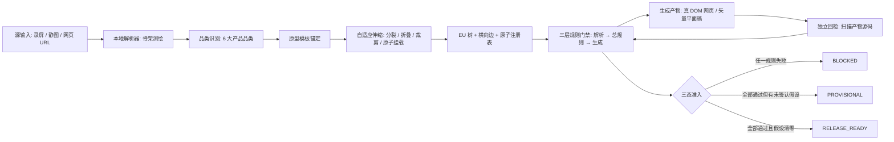
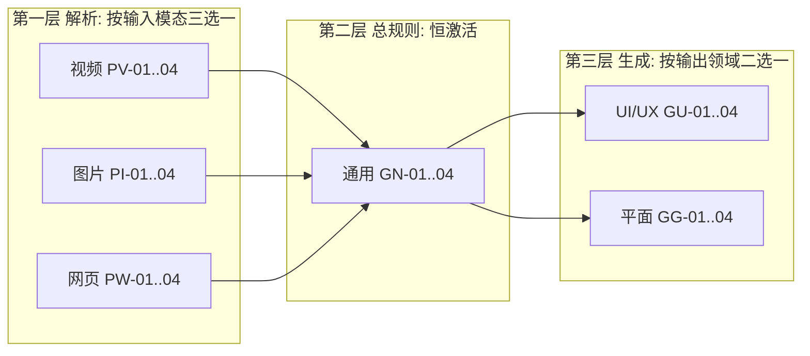
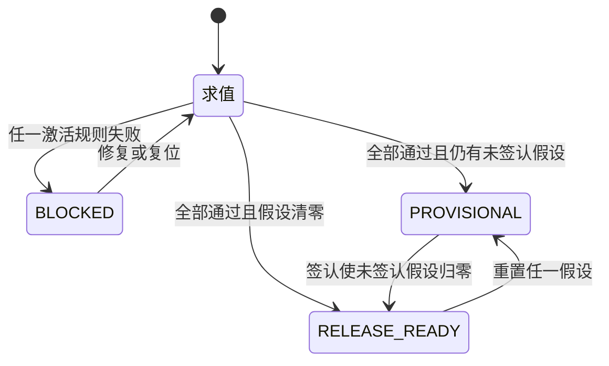

# 开物 · Kaiwu Adaptive-EU Design Workbench 详细介绍

> 版本 `3.4.0`（本地解析与品类模块已按 v4.0 口径接入）　|　默认端口 `4340`　|　运行方式：本地离线、零构建
> 主基线案例：**Code XR · Glass Workspace**（录屏 → UI/UX）　|　同源对照：**Code XR · 品牌视觉展板**（静图 → 平面设计）

---

## 1. 一句话定位

**开物是一套「先拆解、再生成、全程可证伪」的设计复刻工作台。**
它把一段录屏、一张静图或一个网页，统一解析成一棵 **L0~L5 自适应语义树（EU 树）**，经过 **三层正交规则门禁** 逐条把关后，产出**可编辑、可交互、可回检**的 UI 网页或平面印刷稿，并用明确的三态准入告诉你：这份产物到底能不能交付。

---

## 2. 它要解决什么问题

在用 AI 或人工"照着参考做一版界面 / 海报"的过程中，常见失败并不是"做不出来"，而是"**做出来了，但说不清对不对**"。开物针对的正是下面这些在实际项目中真实发生过的问题：

| 痛点 | 典型表现 | 开物的做法 |
| --- | --- | --- |
| 局部冒充整体 | 只核对了录屏中的一小段，就宣布整片通过 | 全时段连续切分，覆盖率必须 100%（PV-01） |
| 未定值被当真值 | 片尾还在滚动的数字被写成最终数据 | 观测值区分稳态 / 瞬态，瞬态只能进入"假设"（PV-03） |
| 结构与交互混建 | 把"邻近放大"拆成好几层父子包含关系 | 纵向树只放结构，交互一律走横向边（GN-01） |
| 截图贴皮 | 用整张截图铺底冒充界面，文字不可选、按钮不可点 | 强制真 DOM 文本与弹性容器，UI 位图面积为 0（GU-02） |
| 交互漏做 | 收起侧栏时漏掉指针邻近放大 | 语义图中每条交互边都必须有可探测的实现（GU-03） |
| 界面写满"解释小字" | "不会丢""仍可用"之类保证句出现在界面上 | 自动回读可见文本，禁用短语命中数须为 0（GU-04） |
| 没证据也算通过 | EU 根本没读到原视频，却被报为已验收 | No-Evidence-No-Verified：无证据不得标为已验证（GN-03） |
| 规则是否真能拦截无从得知 | 规则写了，但从没被触发过 | 24 个反事实预设，真实注入错误，验证规则确实会拦截 |

---

## 3. 核心概念速览

| 概念 | 含义 |
| --- | --- |
| **EU（Element Unit，设计单元）** | 被识别、被约束、被生成、被回检的最小语义单元。每个 EU 有全局唯一 `eu_id`，同时就是产物 DOM 上的 `data-eu-id`。 |
| **L0~L5 六级树** | L0 产品 → L1 领地 → L2 区域 → L3 组件 → L4 特征 → L5 原子；单父、父子层级差恰为 1、每个节点直接子数 ≤ 7。 |
| **横向边（Edge-as-EU）** | 表达交互与联动，只允许 6 类白名单：`TRIGGERS_STATE`、`RESTORES_FOCUS`、`FILTERS_VIEW`、`MODULATES_NEIGHBOR`、`SCROLLS_INDEPENDENTLY`、`SHARES_TOKEN`。 |
| **原子注册表（atomic_registry）** | L5 原子的"单一来源"，分 surface / typography / layout / motion / evidence 五区段；节点通过 `atom_refs` 引用原子，原子以 `used_by` 反指节点（单源双索引）。 |
| **骨架（skeleton）** | 源输入的几何与时间测绘：视口、时段切分、包络框、裁切变换、噪声区、观测值等。 |
| **假设（AssumptionRecord）** | 原始素材无法证实、但生成时必须先定下来的内容，必须显式登记并等待人工签认。 |
| **三态准入** | `BLOCKED`（被拦截）/ `PROVISIONAL`（暂行，可预览但仍有未签认假设）/ `RELEASE_READY`（可交付）。 |
| **反事实预设** | 在内存沙盒中故意制造某一类错误，检验对应规则是否真的会拦截。 |

---

## 4. 整体工作流



---

## 5. Y 型三层正交规则体系

开物的规则不是"一个大清单"，而是按 **输入模态 × 通用约束 × 输出领域** 三层正交组织，形如字母 Y：三种输入汇入同一层总规则，再分流到两种输出领域。



- **全库**：6 个 YAML × 4 条 = **24 条**，全部为 `BLOCKER` 级硬规则。
- **单项目激活**：解析模态 4 条 + 总规则 4 条 + 生成领域 4 条 = **12 条**。
- **求值顺序**：解析 → 总规则 → 生成，层内按规则 ID 升序。
- **零特例原则**：规则文件里不出现任何案例名、时长、坐标、倍率等单项目数值；项目差异只来自骨架、模板与语义图。比如 GU-03 并不点名"邻近放大"，而是对图中每一条 `MODULATES_NEIGHBOR` 边执行同一个探针。

### 5.1 24 条规则一览

| 层 | ID | 规则名称 |
| --- | --- | --- |
| 解析·视频 | PV-01 | 全时段关键帧覆盖与场景切分闭合 |
| 解析·视频 | PV-02 | 视频外版式噪声剥离与有效视口裁切 |
| 解析·视频 | PV-03 | 瞬态滚动与稳态真值分离及假设隔离 |
| 解析·视频 | PV-04 | 帧间不变量与连续交互取证 |
| 解析·图片 | PI-01 | 版面栅格与比例尺寸链闭合 |
| 解析·图片 | PI-02 | 视觉去噪与前景图文 / 背景材质分离 |
| 解析·图片 | PI-03 | 色彩对比度、字阶与间距原子采样合法性 |
| 解析·图片 | PI-04 | 原图 evidence_bbox 强绑定 |
| 解析·网页 | PW-01 | 多断点 DOM 几何闭合 |
| 解析·网页 | PW-02 | 计算样式向设计 Token 归一 |
| 解析·网页 | PW-03 | 交互状态与无障碍角色提取 |
| 解析·网页 | PW-04 | 静态装饰与业务数据边界分离 |
| 总规则 | GN-01 | 树图分离与度约束 |
| 总规则 | GN-02 | 模板锚定与复杂度自适应伸缩合规 |
| 总规则 | GN-03 | 单源双索引 L5 原子 100% 挂载与 No-Evidence-No-Verified |
| 总规则 | GN-04 | 包络自底向上守恒与三态准入状态机 |
| 生成·UI/UX | GU-01 | L5 设计与动效 Token 原子 100% 强制消费 |
| 生成·UI/UX | GU-02 | 根治 UI 实心退化：真可编辑 DOM 文本与弹性容器 |
| 生成·UI/UX | GU-03 | 微交互与状态闭环保真 |
| 生成·UI/UX | GU-04 | 在线舞台与导出产物溯源 ID 回检及零防御性小字 |
| 生成·平面 | GG-01 | 画幅尺寸出血与网格对齐守恒 |
| 生成·平面 | GG-02 | 视觉主次字阶层级与对比度合规 |
| 生成·平面 | GG-03 | 矢量 / 文字图层独立可编辑 |
| 生成·平面 | GG-04 | 导出重开版式零漂移与溯源回检 |

每条规则在 YAML 中都具备统一字段：`bound_eu_levels`（检查哪些层级）、`check_code`（引擎求值函数）、`thresholds`（通用阈值）、`invariants`（伪码不变量）、`failure_boundary`（失败时阻断哪一层、如何归因）以及唯一对应的 `counterfactual_preset`。

---

## 6. 原型模板与自适应语义树

### 6.1 两套原型模板

| 模板 | 领域 | 4 大 L1 领地 |
| --- | --- | --- |
| `tpl_uiux_workspace_v1` | UI/UX | 开场外壳 `intro_shell` · 导航坞 `nav_dock` · 主舞台 `main_stage` · 辅助浮层 `auxiliary_overlay` |
| `tpl_graphic_poster_v1` | 平面 | 品牌页眉 `header_brand` · 主视觉 `hero_key_visual` · 规格网格 `spec_grid` · 版权页脚 `footer_colophon` |

模板规定了 L0~L5 槽位契约、分裂 / 折叠阈值以及必检的横向边类型。平面模板只允许 `SHARES_TOKEN`，交互类边整体裁剪。

### 6.2 自适应伸缩：粗细随复杂度自动调整

固定颗粒度的拆解要么在交互密集区太粗，要么在重复列表处太细。开物以模板为锚，按实际复杂度自动伸缩：

| 操作 | 层级 | 触发条件 | 效果 |
| --- | --- | --- | --- |
| `TEMPLATE_ANCHOR` 模板锚定 | L1 | 模板必填槽位 | 保证骨架稳定 |
| `SPLIT_HIGH_INTERACTION` 高密交互分裂 | L2 / L3 | 交互边数 ≥ 3 | 拆出更细的组件与特征 |
| `FOLD_ARRAY` 同构阵列折叠 | L2 / L3 | 同构兄弟 ≥ 3 | 折叠为"×N 阵列"宿主，防止度溢出 |
| `ATOMIC_MOUNT` 原子挂载 | L5 | 每个 L5 节点 | 挂接注册表原子 |
| `PRUNE_OPTIONAL_SLOT` 可选槽裁剪 | L2 | 源中未出现的可选区域 | 去掉无关分支（必填 L1 不可裁） |

**Code XR 中的落地示例**：

- 分裂：收起态窄侧栏的邻近放大，拆出"搜索球 / 主项 / 邻项 / 距离场"L3 组件与 `L4 feature.proximity_magnify`；
- 折叠：4 张指标卡、6 个环绕头像、6 项快捷动作各折叠为一个阵列宿主；
- 平面展板：裁剪交互分支，展开网格、出血与字阶特征。

### 6.3 树图分离

- **纵向树**只表达"谁包含谁"，节点类型限定为 `product / territory / region / component / feature / atom`，**禁止** `interaction. / event. / state. / edge. / transition.` 前缀；
- **横向边**表达"谁影响谁"，每类边都有对应的生成侧探针：

| 横向边 | 语义 | 回检探针 |
| --- | --- | --- |
| `TRIGGERS_STATE` | 控件触发状态 / 路由变化 | 目标状态前后不同 |
| `RESTORES_FOCUS` | 浮层关闭后焦点归还 | 关闭后焦点回到触发器 |
| `FILTERS_VIEW` | 过滤器切换数据视图与导出 | 数据集变化且导出口径一致 |
| `MODULATES_NEIGHBOR` | 指针距离调制邻项尺寸 | 主项 > 邻项 > 1.0，远项 = 1.0，离开复位 |
| `SCROLLS_INDEPENDENTLY` | 宿主独立滚动、兄弟区静止 | 宿主位移 > 0 且兄弟位移 = 0 |
| `SHARES_TOKEN` | 两节点共享同一设计 Token | 由 GU-01 / GG-02 覆盖 |

视频模态中观测到的边还必须附带时间段 `[t0, t1]` 与帧内框 `frame_bbox` 证据（PV-04）。

---

## 7. 诚实放行：证据、假设与三态准入

### 7.1 No-Evidence-No-Verified

任何标为 `verified` 的节点都必须挂接 evidence 原子；实体型 L3 子树的 L5 原子覆盖率必须达到 100%。拿不到证据的内容，只能作为**假设**登记。

### 7.2 假设登记

以 Code XR 为例，初始未签认的假设包括：片尾 Analytics 仍在滚动的数字、原片未展示的 3/6/12 月 CSV 明细口径、替代用的室内背景图等。每条假设都绑定到具体 EU 和规则，可在工作台中逐条签认或重置。

### 7.3 准入状态机



这意味着：**"网页跑起来了"不等于"可以交付"**。只要还有一条未经确认的推断，系统就会诚实地停在 `PROVISIONAL`。

---

## 8. 反事实沙盒：证明规则真的会拦截

- 24 条规则各对应 1 个反事实预设（命名格式 `violate_<规则ID>_<语义>`，如 `violate_GN01_interaction_in_tree`）；
- 每次测试都会**深拷贝**当前案例快照，按预设真实改写 IR / 骨架 / 回检快照，再交给**同一个**规则引擎求值，正式快照不受影响；
- **首障归因**：结果中的 `violated_rule_id` 必须是预设的目标规则，且该规则在本次求值中确实失败，否则视为引擎缺陷；其他连带失败的规则列在 `co_failed_rule_ids`；
- 使用 `reset` 一键恢复正式快照。

---

## 9. 生成侧独立回检

`backend/generator_readback.py` 不信任生成过程的自述，而是**直接扫描**产物源码（`cases/*/app/`），输出：

- DOM 中 `data-eu-id` 的覆盖率与唯一性；
- 可编辑文本节点数、真实交互控件数；
- 是否支持 `prefers-reduced-motion`；
- 390px 窄屏响应式是否成立；
- 平面稿的活文字 / 矢量可编辑性；
- 防御性小字命中数。

生成层的 GU-01..04 / GG-01..04 全部基于这份回检快照求值。

---

## 10. 产品品类体系

在三层规则之上，开物还内置 6 大产品品类（`categories/*.yaml`），用于自动识别输入属于哪类产品，并追加品类专属检查项（如 `CAT-DASH-01..03`）：

| 品类 ID | 名称 | 级别 | 默认领域 | 适用对象 |
| --- | --- | --- | --- | --- |
| `app_dashboard` | 数据看板 / SaaS 工作台 | core | UI/UX | 带主导航、KPI 指标、图表、表格与筛选导出的后台产品 |
| `collab_planner` | 排班 / 日历协作工具 | core | UI/UX | 资源排班、周计划日历、工时汇总与协作状态 |
| `data_hud` | 高密度数据 HUD / 查询台 | core | UI/UX | 开发者观测平台、查询控制台、极暗工程监控 |
| `brand_landing` | 品牌官网 / 硬件发布页 | extended | UI/UX | 产品发布官网、硬件展示站，允许 3D / 摄影 / Shader 资产槽 |
| `editorial_grid` | 粗野网格 / 作品集画廊 | extended | UI/UX | 新粗野主义工作室、Bento 作品集、实验刊物 |
| `print_graphic` | 瑞士网格平面 / 海报 | extended | 平面 | ISO A3 展板、瑞士国际风格海报、矢量印刷规范页 |

---

## 11. 本地三模态解析器

全部在本机运行，**不调用任何外部 API**：

| 解析器 | 输入 | 实现要点 |
| --- | --- | --- |
| 网页 URL 解析 `web_url_parser` | 网址 | 无头 Chromium（Playwright）在 1440 / 768 / 390 三个视口实测 DOM 几何，聚类计算样式为 Token，识别交互控件、资产槽位与产品品类，输出归一化骨架与 EU 树 |
| 静图解析 `image_local_parser` | PNG / JPG | 仅用 Pillow + NumPy：主色 K-means 聚类、双层区域分割、对比度采样，并生成 **Set-of-Mark 标号图**，便于 Agent 看图归组 EU 并区分 `ui_dom` / `asset_slot` |
| 录屏解析 `video_frame_parser` | 帧序列目录或 MP4 / WebM | 无需 ffmpeg / OpenCV：通过无头浏览器离线均匀抽帧，计算稳态关键帧与 12×8 网格帧差热点，推断横 / 纵交互边候选 |

解析结果落地为 `cases/<id>/parsed_case.json`，工作台会自动发现并纳入案例列表。

---

## 12. 案例库（21 个）

覆盖 **4 个录屏、2 张静图、15 个网页**，跨越 6 大品类与多种迥异视觉流派。所有案例均通过 12 条激活规则，当前处于诚实的 `PROVISIONAL` 状态，等待假设签认。

| 案例 | 名称 | 路由 | 品类 | 特征 |
| --- | --- | --- | --- | --- |
| `code_xr_uiux` | Code XR · Glass Workspace | 视频 → UI/UX | 数据看板 | 5.689 s · 6 时段 100% 覆盖（**主基线**） |
| `code_xr_poster` | Code XR · 品牌视觉展板 | 图片 → 平面 | 平面海报 | ISO A3 · 12 栏瑞士网格（**同源对照**） |
| `rauno_craft_video` | Rauno · Craft Motion Lab | 视频 → UI/UX | 数据 HUD | 4.8 s · 慢动作微交互实验 |
| `fps60_motion_video` | 60fps · Physics Motion Gallery | 视频 → UI/UX | 品牌官网 | 4.4 s · 弹簧分裂与共享变形 |
| `screen_studio_video` | Screen Studio · Auto-Zoom Timeline | 视频 → UI/UX | 数据看板 | 5.2 s · 自动运镜与多轨编辑 |
| `monolog_swiss_poster` | MONOLOG · 瑞士杂志网格展板 | 图片 → 平面 | 平面海报 | ISO A3 · 瑞士杂志网格 |
| `refract_crm_web` | Refract · Liquid-Glass CRM | 网页 → UI/UX | 数据看板 | 液态玻璃折射 |
| `haven_admin_web` | Haven · Glass Admin Workspace | 网页 → UI/UX | 数据看板 | 空间表盘与波形 |
| `linear_workspace_web` | Linear · Isometric Issue Workspace | 网页 → UI/UX | 数据看板 | 等轴测与 Diff 台 |
| `poolsuite_os_web` | Poolsuite · 90s Retro Mac OS | 网页 → UI/UX | 数据看板 | 复古拟物多窗桌面 |
| `family_fluid_web` | Family · Fluid Morphing Tray | 网页 → UI/UX | 数据看板 | 纯白云朵变形抽屉 |
| `axiom_hud_web` | Axiom · Dark Data HUD | 网页 → UI/UX | 数据 HUD | 极暗精工终端 |
| `resend_dev_web` | Resend · Email Developer Console | 网页 → UI/UX | 数据 HUD | 光束与流式 API |
| `raycast_cmd_web` | Raycast · Command Palette & Keyboard | 网页 → UI/UX | 数据 HUD | 命令面板与键阵 |
| `nothing_dot_web` | Nothing · Dot-Matrix OS HUD | 网页 → UI/UX | 数据 HUD | 工业纯黑红点阵 |
| `weeksync_paper_web` | WeekSync · Paper Planner | 网页 → UI/UX | 排班协作 | 奶油纸感排班 |
| `amie_collab_web` | Amie · Joyful AI Notes & Planner | 网页 → UI/UX | 排班协作 | AI 纪要与胶囊 |
| `daylight_eink_web` | Daylight · Amber E-Ink Paper | 网页 → UI/UX | 排班协作 | 反射琥珀电子纸 |
| `knob_hardware_web` | KNOB · Industrial Hardware | 网页 → UI/UX | 品牌官网 | 工业实体旋钮 |
| `defined_aurora_web` | Defined · Aurora Ferrofluid | 网页 → UI/UX | 品牌官网 | 极光磁流体 |
| `nogood_brutal_web` | NoGood · Neo-Brutalist Studio | 网页 → UI/UX | 粗野网格 | 酸性绿新粗野 |

每个案例目录包含：`app/`（可交互产物）、`frames/`（关键帧或参考图）、`skeleton_ir.json`（骨架 IR）、`skeleton_overlay.svg`（骨架叠图）、`inspection_bundle.json`（完整检验包），部分含 `assumptions_state.json`（假设签认状态）。

### 主基线：Code XR 六时段切分

| 时段 (s) | 内容 |
| --- | --- |
| 0.00 – 0.75 | 品牌揭幕 |
| 0.75 – 1.60 | 亮区展开与数值稳定 |
| 1.60 – 2.23 | 窄侧栏邻近放大 |
| 2.23 – 3.80 | 展开侧栏与 Dashboard 首屏 |
| 3.80 – 4.85 | 主区独立下滚 |
| 4.85 – 5.689 | Analytics 切页 |

---

## 13. 检验工作台（前端）

零构建的原生 HTML / CSS / JS，离线可用，采用"宣纸瑞士"视觉风格的**三窗格联动**布局：

| 区域 | 内容 |
| --- | --- |
| 顶栏 | 案例切换、三层门禁总览、反事实预设选择 |
| 左窗格 · 源输入与骨架 | 关键帧 / 参考图、骨架叠图、时间轴分段（底部骨架测绘坞可调高） |
| 中窗格 · 自适应 EU 与门禁 | **EU 树**（可搜索、带自适应徽标）· **门禁**（三层 12 条规则逐条结果与指标）· **残差台账**（RES-KW） |
| 右窗格 · 真实产物与回检 | iframe 内嵌可交互产物，附回检摘要 |
| 弹窗 | "真机 URL 三断点自动解析与品类分类"导入器；"开物工作台 · 自举 EU 语义与 Token 实时审计"（工作台用自身的 EU 体系审计自己） |

**三屏联动**：在中窗格点选 EU → 右侧产物与左侧骨架同步高亮；在产物里点击元素 → 中窗格定位到对应 EU 并展开解释链（祖先、L4 特征、L5 原子、相关横向边、假设与绑定规则）。联动通过 `postMessage` 协议（`KAIWU_HIGHLIGHT_EU` / `KAIWU_SELECT_EU` / `KAIWU_PREVIEW_ACTION`）实现。

---

## 14. 接口与 AI 工具

### 14.1 REST API（`backend/server.py`）

| 方法 | 路径 | 作用 |
| --- | --- | --- |
| GET | `/api/health` | 服务状态、规则 / 模板 / 品类加载数、本地解析器列表 |
| GET | `/api/cases` | 案例列表与品类 |
| GET | `/api/categories` | 6 大品类 |
| GET | `/api/rules` | 24 条规则目录、模板与 AI 工具 schema |
| GET | `/api/case/{case_id}/bundle` | 完整检验包：骨架、EU 树、门禁、假设、回检、预设、台账 |
| GET | `/api/case/{case_id}/explain/{eu_id}` | 单个 EU 的解释链 |
| POST | `/api/case/{case_id}/test_rule_gate` | 执行反事实预设或复位 |
| POST | `/api/case/{case_id}/confirm_assumption` | 签认 / 重置 / 全部签认假设 |
| GET | `/api/error_ledger` | 残差台账 |
| POST | `/api/parse/url` · `/api/parse/image` · `/api/parse/video` | 本地三模态解析导入 |

静态挂载：`/` → `frontend/`，`/cases/` → `cases/`。

### 14.2 AI-First 工具（`backend/ai_tools_mcp.py`）

与 REST API 共用同一引擎，可供 Agent 直接调用，也可命令行运行：

`extract_skeleton` · `build_adaptive_eu` · `audit_three_layer_gates` · `simulate_counterfactual` · `manage_assumptions` · `verify_and_publish_bundle` · `list_categories` · `parse_url_live` · `inspect_image_som` · `inspect_video_diff`

---

## 15. 残差台账：从真实错误中长出来的规则

`UI与交互EU错误排查台账.md` 沉淀了项目过程中真实出现过的 8 条残差，每条绑定唯一主规则与反事实预设，状态均为 `closed_by_rule`（已能被规则自动拦截，且反事实实测阻断）：

| 编号 | 问题 | 主规则 |
| --- | --- | --- |
| RES-KW-01 | 局部录屏冒充整片验收 | PV-01 |
| RES-KW-02 | 片尾滚动数字当定值 | PV-03 |
| RES-KW-03 | 视频版式代码窗混入界面 | PV-02 |
| RES-KW-04 | 交互塞入纵向组件树 | GN-01 |
| RES-KW-05 | 位图贴皮实心退化 | GU-02 |
| RES-KW-06 | 收起侧栏漏掉邻近放大 | GU-03 |
| RES-KW-07 | 界面放解释性、防御性小字 | GU-04 |
| RES-KW-08 | EU 缺席却报整体验收 | GN-03 |

> 设计理念：**同类错误今后在对应层被 `BLOCKED`，而不是靠人记得。**

---

## 16. 快速开始

```powershell
# 启动服务
python backend/server.py --port 4340
# 浏览器打开 http://127.0.0.1:4340/

# 运行独立验收
python tests/verify_v34_kaiwu.py
python tests/verify_parsers_and_categories.py
```

**依赖说明**

- 核心引擎、规则门禁与工作台：仅需 Python 标准库（若已安装 PyYAML 则优先使用）；
- 静图 / 录屏解析：需要 Pillow 与 NumPy；
- 网页 URL 解析与 MP4 抽帧：需要 Playwright（无头 Chromium）。

---

## 17. 质量验收

`tests/verify_v34_kaiwu.py` 构成独立验收矩阵，最近一次报告（`tests/v34_verification_report.json`，2026-11-23）结果为 **59 / 59 全部通过**：

| 验收类别 | 通过 / 总数 |
| --- | --- |
| 规则与模板结构 | 17 / 17 |
| 自适应 EU 与准入生命周期 | 5 / 5 |
| 反事实门禁 | 25 / 25 |
| API 与回检 | 6 / 6 |
| 真实浏览器端到端 | 6 / 6 |

验收口径包括：24 条规则结构完整且零单项目数字；L0~L5 无跳层、单父无环、度 ≤ 7、纵向树零交互节点；实体 L3 原子覆盖率 100%；Code XR 全片覆盖率 100%；`PROVISIONAL → RELEASE_READY → PROVISIONAL` 生命周期可往返；24 个反事实逐一在目标层被拦截且首障归因正确；1440×900 真实浏览器零控制台报错、零防御性小字、三屏联动与邻近放大实测生效。

---

## 18. 目录结构

```text
开物/
├─ VERSION / README.md / CHANGELOG.md
├─ UI与交互EU错误排查台账.md        RES-KW-01..08
├─ docs/
│  ├─ ARCHITECTURE_v3.4.md          架构与 JSON API 契约（权威）
│  └─ 开物_详细介绍.md               本文
├─ rules/                           6 个规则 YAML（24 条）
├─ templates/                       2 个原型模板
├─ categories/                      6 个产品品类
├─ backend/
│  ├─ server.py                     HTTP 服务与 REST API
│  ├─ adaptive_eu_engine.py         自适应 EU 引擎与规则求值
│  ├─ skeleton_extractors.py        骨架提取
│  ├─ generator_readback.py         生成侧独立回检
│  ├─ category_registry.py          品类识别与审计
│  ├─ cases_catalog.py / styles_catalog.py / motion_catalog.py   案例库
│  ├─ ai_tools_mcp.py               AI-First 工具
│  └─ parsers/                      网页 / 静图 / 录屏本地解析器
├─ cases/                           21 个案例
├─ frontend/                        三窗格检验台
└─ tests/                           验收脚本与报告
```

---

## 19. 版本演进

| 版本 | 要点 |
| --- | --- |
| v3.3 | Code XR 复刻初版；只补查了 1.60–2.23 s 的局部片段，整片未结案，暴露出 RES-KW-01..08 等问题 |
| **v3.4** | 净室重建：Y 型三层正交规则（24 条）、原型模板与自适应伸缩、树图分离、单源双索引原子、三态准入、24 个反事实预设；Code XR 整片 6 段 100% 结案；新增同源平面对照案例 |
| v3.4 扩展（v4.0 口径） | 本地三模态解析器（网页 / 静图 / 录屏）、6 大产品品类、案例库扩展至 21 个、工作台导入器与自举审计 |

---

## 20. 术语表

| 术语 | 解释 |
| --- | --- |
| EU | Element Unit，设计单元 |
| IR | Intermediate Representation，语义中间表示 |
| Token | 设计变量（颜色、字号、间距、动效时长等） |
| SoM | Set-of-Mark，带编号标记的图像，便于模型按编号引用区域 |
| 包络（envelope_bbox） | 节点占据的矩形区域，子节点不得越出父节点 |
| 出血（bleed） | 印刷稿超出裁切线的延伸区域 |
| 防御性小字 | 界面上为"自证清白"而写的解释、保证类文案 |
| 首障归因 | 反事实测试中，将失败归因到预设的目标规则 |
